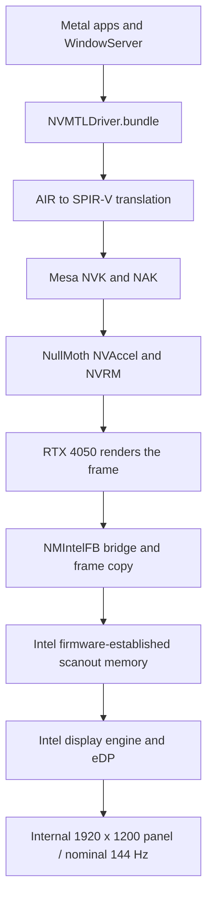

# ASUS V3607VU · macOS Tahoe Hackintosh


**An ASUS V3607VU Hackintosh with RTX 4050 Metal rendering on the Intel-connected internal display.**

This is the configuration running on my laptop (works on all Asus V3607 (Asus Vivobook 16 Series) laptops) as of **November 1, 2026**. The NVIDIA GPU renders the desktop; a customized **NMIntelFB** bridge presents its frames through the Intel display engine. The internal panel keeps its firmware-established native timing. This configuration works on the laptop's own screen without an external monitor or a dGPU-only panel connection.

Everything I use day to day works except sleep. The tables below list working features and the checks I still need to complete. The graphics drivers remain experimental; I have not comprehensively tested application compatibility or long-term stability.

> **Read before installing:** the repository contains a sanitized EFI configuration, custom ACPI/USB files, the working NMIntelFB build and source, and graphics service scripts. Standard OpenCore and kext dependencies must be supplied from upstream. This is not a complete bootable EFI or macOS installer. Generate your own SMBIOS identity and follow the [installation guide](Docs/INSTALLATION.md). Copying the EFI alone does not install the macOS-side Metal stack.

## Hardware and tested environment

| Component | This machine |
|---|---|
| Laptop / firmware | ASUS **V3607VU**, BIOS **.305** |
| Processor | Intel **Core 5 210H**, Raptor Lake family |
| RAM | **32 GB** |
| Intel graphics | **8086:A7AB**, revision 04; 48 EUs identified during the earlier graphics investigation |
| NVIDIA graphics | **GeForce RTX 4050 Laptop GPU**, **10DE:28A1**, **6 GB** VRAM |
| Internal display | **1920 × 1200**, nominal **144 Hz**; EDID model `MNG007QX2-2` |
| Wireless | Intel **BE200**, Wi-Fi PCI ID **8086:272B** |
| Audio | Realtek **ALC256**, `10EC:0256`; HDA controller `8086:51CA` |
| Touchpad | **ASCP1201 / PNP0C50**, `PC00.I2C4.TPD0`; controller `8086:51C5` |
| NVMe | MSI **M480 PRO 2TB**, TRIM enabled |
| macOS | **Tahoe 26.7.2**, build **25G332**, Darwin **25.6.0** |
| OpenCore | **1.0.8 DEBUG**, `DBG-108-2026-09-27` |
| SMBIOS model | **MacBookPro16,1**; personal serial, MLB, UUID and ROM removed |
| NVIDIA stack | **NullMoth 2.6.5**, Tahoe NVAccel variant |
| Panel bridge | **NMIntelFB 0.1**, NullMoth **v2.5.4** base + nmx-intel patches **0001–0021**, NVIDIA **615.78.08** KAPI headers |

I verified these hardware identifiers on my laptop. The Intel GPU is **A7AB**; use this actual PCI ID when comparing configurations rather than inferring it from the CPU model.

## What works

| Feature | Status / evidence |
|---|---|
| Internal screen | Working at native 1920 × 1200 through the NVIDIA → Intel bridge |
| Metal | RTX 4050 is a Metal 3 device; real MSL compilation and GPU compute dispatch passed, with **256 correct results** |
| Accelerated desktop | Working smoothly; transferred-frame counters increase with **zero copy errors** in recorded checks |
| High refresh rate | Nominal **144 Hz**; direct frame-counter measurement **143.692 Hz**. Current macOS mode reports **143 Hz**; an earlier boot reported 144 Hz |
| Wi-Fi | Working, confirmed; BE200 connects with the **AirportBZ Tahoe** driver |
| Bluetooth | Working in my original setup; support remains configured. The controller was **off** during my latest checks, so I did not retest pairing |
| Touchpad | Working through VoodooI2C / VoodooGPIO / VoodooI2CHID; bottom-right secondary click confirmed |
| Independent scroll direction | Scroll Reverser configured for the touchpad only; external mouse direction preserved |
| Built-in audio | Working; CoreAudio exposes internal speakers and microphone; AppleALC + SimpleHDA loaded |
| Battery reporting | Percentage and AC state present; SMCBatteryManager + ECEnabler loaded |
| Keyboard / backlight | Keyboard working and backlight illumination confirmed. Original Fn+F4 control did not respond during testing; complete hotkey coverage is unverified |
| Shutdown / restart | Restart works; a complete shutdown was confirmed after the BIOS-specific S5 fix |
| USB-C | Working, confirmed; individual transfer rates and alternate-mode capabilities were not separately measured |
| HDMI output | Not tested yet |
| Storage | NVMe detected, SMART verified, TRIM enabled |

## Known limitations

- **Sleep/wake is unsupported and system sleep is disabled.** The Intel display engine is not reliably restored after sleep. Hibernation has not been established as a working substitute; related nmx-intel experiments also failed to restore the panel.
- **HDMI output has not been tested.** USB-C is working; specific transfer rates, USB-C video output and multi-monitor operation have not been separately characterized.
- **BE200 does not mean full Wi-Fi 7 support.** AirportBZ excludes WPA3-only / mandatory-PMF networks, 6 GHz, MLO and AWDL/AirDrop. WPA2 on 2.4/5 GHz is the documented baseline.
- **Booting takes longer than a conventional supported graphics setup.** The bridge retains a 45-second handoff delay. Total boot time can exceed it; removing a separate fixed 15-second pause did not establish a measured overall speedup.
- The **RTX stays active** for desktop rendering. Battery runtime, thermals, hardware video decoding, DRM, CUDA and broad professional-app compatibility have not been benchmarked or certified here.
- The tested graphics profile **relaxes SIP/AMFI protections**. Exact values are recorded below. FileVault was off during setup; Apple account services are not validated by this repository.

## How RTX rendering reaches the Intel panel

The built-in panel is wired to Intel. Merely installing the NVIDIA driver can make the RTX appear in Metal while the desktop still uses an unaccelerated firmware framebuffer. NMIntelFB supplies the missing display path.



**NVIDIA performs the rendering; Intel performs the final display scanout.** The Intel CPU is not replacing a Metal GPU. This is a software bridge, with no hardware MUX switch or Apple automatic GPU-switching implementation involved.

The NVIDIA stack includes `NVMTLDriver.bundle`, its shader translator and NVK back end, plus `NVRM`, `NVAccel`, `NVRMFB` and `NVRMAGDC`. The locally built `NMIntelFB.kext` adds the Intel-connected panel. All five graphics kexts reside in **`/Library/Extensions`** and load through the Auxiliary Kernel Collection. The Metal plugin and supporting libraries live under **`/Library/GPUBundles`**. They are **not EFI-injected graphics drivers**. See [NullMoth's architecture](https://github.com/nullmoth/nvidia-macos-driver/blob/v2.6.5/docs/HOW-IT-WORKS.md).

This ASUS adaptation keeps the display state that firmware already established:

- **CMTG is active**, with `CMTG_CTL = 0x80800000` and the transcoder secondary bit set.
- The adopted framebuffer is **1920 × 1200**, with a **7680-byte stride**.
- All **16,384 GGTT mappings** checked over the first **64 MiB** matched the expected framebuffer memory.
- A direct sample counted **36 frames in 250.535 ms**, or approximately **143.692 Hz**, consistent with nominal 144 Hz.

The working profile uses the basic copy path. Optional nmx-intel RAM-scanout remapping and additional NVAccel/NVRM fast-copy patches were not applied. The installed bridge's Intel PCI match is narrowed to **`0xA7AB8086`**.

This work derives from [kitsuneislife/nmx-intel](https://github.com/kitsuneislife/nmx-intel), whose published reference machine is an Acer with A7A8 + RTX 3050 on Sequoia. The local results here are specifically **ASUS A7AB + RTX 4050 on Tahoe**. They do not establish support for every laptop in those families.

## Why the Intel-only path was set aside

The earlier WhateverXe 0.6.1 attempt hit two distinct firmware issues. First, this BIOS reports VBT panel type **`0xFF`**, rejected by the original selection logic. Matching the panel's real EDID to **VBT entry 2** fixed that selection issue and passed offline tests. The driver then still could not take over the active **CMTG** timing state.

Consequently, the Intel-only attempt did not establish a working Metal desktop. **WhateverXe is disabled in this configuration.** The successful profile uses NVIDIA rendering and preserves Intel scanout. The EDID-related device properties and PNLF SSDT remain in the snapshot; they do not indicate that WhateverXe is active.

## Model-specific configuration

| Area | Applied fix |
|---|---|
| Touchpad | VoodooGPIO loads before VoodooI2C; polling resources for `PC00.I2C4.TPD0`. Controller match dictionaries preserved in `Overrides/` |
| Keyboard illumination | AsusSMC 1.4.1 + `SSDT-ASUS-KBL`: bridges `SKBV` to firmware `ATKD.SLKB`, scales 0–255 to ASUS 0–3. The fixed **150 lux** ALS is synthetic |
| Repeated ASUS WMI errors | `SSDT-ASUS-WMI` pads short Darwin requests to **20 bytes** before calling renamed `WMNB`, avoiding errors from AsusSMC's 8-byte requests |
| Shutdown | Root `_PTS` wrapper runs the original firmware preparation, then clears `PC00.XHCI.PMEE` and `PC00.LPCB.SLPE` **only for Darwin S5** |
| Battery | SMCBatteryManager **1.3.8** + ECEnabler **1.0.6** |
| Audio | **Lilu → AppleALC 1.9.8 → SimpleHDA 1.0.0**, `alcid=5`, `keepsyms=1` |
| Wi-Fi | AirportBZ **v1.0.0 Tahoe build**, named `AirportItlwm.kext`, restricted to Darwin 25; no OCLP wireless root patch |
| Bluetooth support | IntelBluetoothFirmware / IntelBTPatcher **2.5.2**, BlueToolFixup **2.7.2** |
| USB | Custom `USBMap-ASUS.kext` and XHCI match support; USBToolBox / UTBMap disabled |

The ACPI renames are scoped to **BIOS .305**, including the **687,609-byte DSDT** and exact method signatures. Review them before using another BIOS. Four available ASUS SSDT sources accompany the eight enabled AML tables; the others are retained as compiled configuration artifacts. See [configuration details](Docs/CONFIGURATION.md).

## Boot services and recovery

Two graphics services are required:

- **`com.nmxintel.intelfb-auto`** waits for the Intel panel and NVIDIA services and enables AGDC/frame transfer. If no frames arrive after 90 seconds, it can restart WindowServer once **at the login window**. It does not take that action while a normal user owns the console.
- **`com.nullmoth.bootguard`** manages the NVIDIA driver's separate boot-success counter.

The local bridge script replaces an unconditional 15-second post-panel pause with readiness checks, while keeping the **45-second** handoff delay. It also corrects an early orderly shutdown leaving `nullmoth-intelfb-attaching` set: cleanup is permitted only after positive frame transfers, zero transfer errors, active AGDC/IOP and panel timing are verified. Failed starts retain their guard.

A stale guard previously caused white wallpaper and a slow desktop even though the RTX Metal device was listed. **Check both a real Metal workload and advancing panel-transfer counters.** [Troubleshooting](Docs/TROUBLESHOOTING.md) documents this failure and `GPU Recovery - NVIDIA OFF`.

## Exact graphics-related settings

```text
boot-args:
-v keepsyms=1 debug=0x100 revpatch=sbvmm -vi2c-force-polling -ibtcompatbeta nvfb=1 nvaccel=1 nvfbheads=4 -nvkmsnosmooth amfi_get_out_of_my_way=0x1 amfi=0x80 ipc_control_port_options=0 alcid=5

csr-active-config: 430A0000 (Data; little-endian value 0x0A43)
SecureBootModel: Disabled
```

The separate NVRAM variable **`nullmoth-intelfb-delay=45`** and sleep policy must also be set; they are not contained in the EFI plist. **`IONDRVSupport` is not blocked** in this machine's profile, preserving firmware display recovery. Existing BAR quirks are retained instead of copying the upstream discrete-monitor example.

## Files and reproduction

```text
EFI/OC/                  Sanitized config, eight AMLs and custom USB map
ACPI/Sources/            Four available model-specific ASUS SSDT sources
Overrides/               I2C/GPIO and XHCI matching property lists
Graphics/                Working NMIntelFB binary, source, patches and boot services
Scripts/                 Local EFI assembly and read-only verification tools
Manifests/               Exact dependency versions and SHA-256 fingerprints
Docs/                    Installation, configuration, recovery and evidence
Licenses/                Third-party license notices
```

I based the shared configuration on my latest EFI recovery snapshot from November 1 and verified the running graphics, audio and battery stack that day. I removed personal SMBIOS identifiers and excluded private backups, Wi-Fi names and account data. Standard upstream binaries, NVIDIA userspace/firmware and the SimpleHDA/AppleHDA payload are obtained from their authors.

1. Follow [installation](Docs/INSTALLATION.md), obtain the [dependencies](Manifests/efi-dependencies.json), and assemble a local EFI with your own identity.
2. Validate it with **OpenCore 1.0.8 `ocvalidate`** and test from a recovery-capable USB.
3. Install the macOS-side graphics components separately.
4. Run `bash Scripts/check-runtime.sh` and `bash Scripts/test-metal.sh`; the compute test requires Xcode Command Line Tools.
5. Compare with the [sanitized verification record](Docs/VERIFICATION.md).

## Credits and licensing

The NVIDIA/Metal stack is by **[NullMoth](https://github.com/nullmoth/nvidia-macos-driver)**. The Intel-panel bridge patches are by **[kitsuneislife/nmx-intel](https://github.com/kitsuneislife/nmx-intel)**. This repository documents my ASUS configuration and model-specific fixes.

Thanks to [Acidanthera](https://github.com/acidanthera), [VoodooI2C](https://github.com/VoodooI2C/VoodooI2C), [AsusSMC](https://github.com/hieplpvip/AsusSMC), [AirportBZ](https://github.com/HuajiFruit/AirportBZ), [OpenIntelWireless](https://github.com/OpenIntelWireless), [SimpleHDA](https://github.com/laobamac/SimpleHDA), [ECEnabler](https://github.com/1Revenger1/ECEnabler), [Dortania](https://dortania.github.io/OpenCore-Install-Guide/) and [Scroll Reverser](https://pilotmoon.com/scrollreverser/).

MIT covers original documentation, configuration and utilities, subject to [third-party exclusions](THIRD_PARTY_NOTICES.md). The NullMoth-derived bridge retains **PolyForm Noncommercial 1.0.0** terms; the root MIT license does not relicense it.
